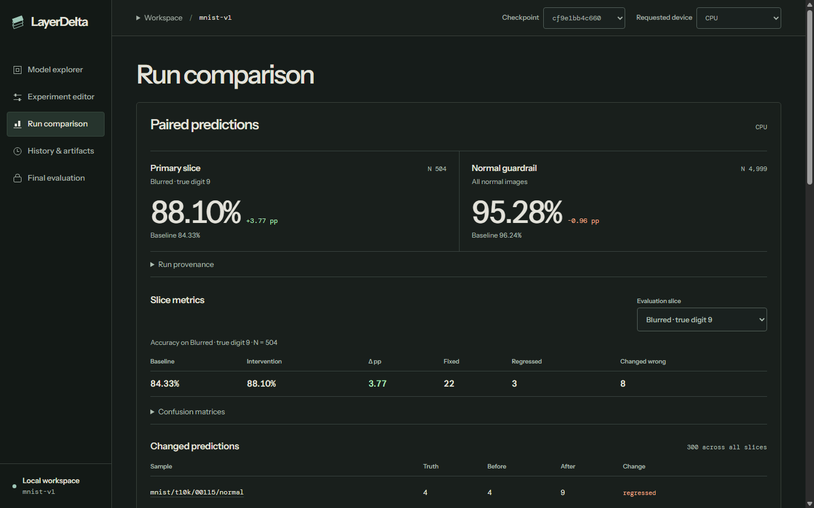

# LayerDelta

LayerDelta is a local workbench for measuring how a change to one neural-network component affects individual predictions. Today it targets a two-block MNIST CNN on Windows x64: select a normal/blurred image pair, inspect its feature maps, change one activation or kernel, then compare the images that improved and the ones that regressed. The desktop app and the typed Agent client run the same experiment engine on CPU or NVIDIA CUDA.

The goal is to let people and AI agents inspect and edit neural-network weights across model families, with every experiment recorded so it can be reproduced and audited.

## Status

LayerDelta is under **active development**. There is no public release yet: the v0.1 reference workbench is complete as an internal build, and later milestones are in progress or planned. See the [roadmap](docs/roadmap/Roadmap.md) for milestones and current status.

## Quickstart

- **Using the app on Windows:** follow the [Windows quickstart](docs/guides/windows-quickstart.md) to run the packaged installation and your first experiment.
- **Letting an AI agent drive experiments:** see the [agent integration guide](docs/guides/agent-integration.md).
- **Developing LayerDelta:** see [CONTRIBUTING.md](CONTRIBUTING.md) for the development setup, tests and pull request conventions.

## Documentation

All documentation is indexed in [docs/README.md](docs/README.md), including the reference docs for the HTTP API and the inspection and edit formats, the architecture notes, the roadmap, the design specs, and the historical records.

## License

LayerDelta code is licensed under the [Apache License 2.0](LICENSE). Rights to checkpoints and datasets are checked separately from the code license; see the distribution notes in the [release notes](docs/history/release-notes.md).
