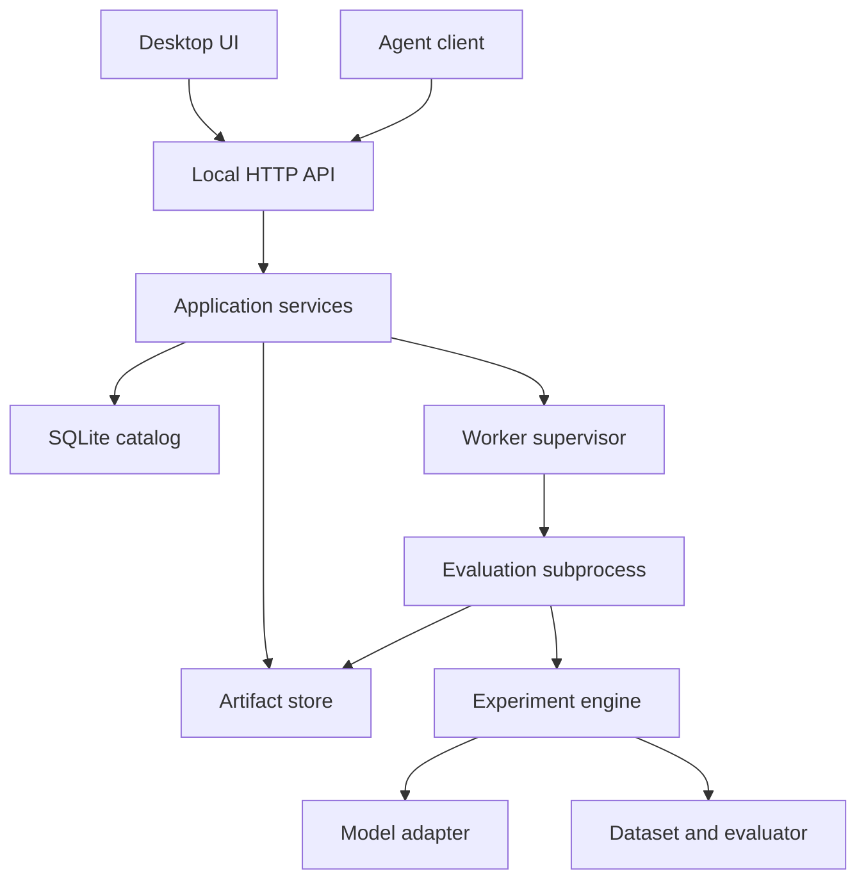
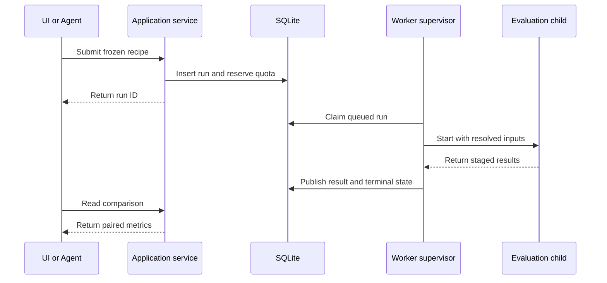

# LayerDelta — Architecture

The M2 implementation uses the [FastAPI transport](../src/layerdelta/api.py), [SQLite supervisor](../src/layerdelta/store.py) and [isolated workers](../src/layerdelta/job.py). Each workspace has one supervisor, a queue and immutable published run directories. Both Windows CPU and NVIDIA CUDA execute the same adapter. The [desktop launcher](../desktop/launcher.py) serves the React renderer from the API's loopback origin. The [typed Python client](../src/layerdelta/client.py) uses the same request models as the HTTP service.

| รายการ | รายละเอียด |
|---|---|
| สถานะ | Implemented (v0.1, internal). Target design for v0.2+ is in [Architecture_Target](Architecture_Target.md); milestones in [Roadmap](Roadmap.md) |
| วันที่ | 22 พฤศจิกายน 2026 |
| ขอบเขต | Local-first, single-user workspace, PyTorch CNN หนึ่ง architecture |
| เอกสารอ้างอิง | [LayerDelta PRD v0.1](LayerDelta_PRD_v0.1.md) |

## 1. การตัดสินใจหลัก

ใช้ **modular monolith ในเครื่องผู้ใช้** โดย backend เป็นเจ้าของสูตรทดลอง งานในคิว สิทธิ์เข้าถึง และผลวัด การประเมินโมเดลทำใน process ลูกแยกต่อ run โดย v0.1 รันได้ครั้งละหนึ่งงาน UI และ Agent เรียก application services ชุดเดียวกัน CLI ใน PoC เรียก runner ผ่านสัญญาการทดลองเดียวกัน

| ส่วน | ทางเลือกเสนอสำหรับ MVP | เหตุผล |
|---|---|---|
| Backend | Python, FastAPI และ Pydantic | ใช้ runtime เดียวกับ PyTorch และแชร์ schema validation ระหว่าง entry points |
| Inference | PyTorch CPU reference runtime | กำหนดสภาพแวดล้อมอ้างอิงสำหรับ replay และทดสอบ CNN ตัวอย่าง |
| Desktop UI | Desktop shell ครอบ React + TypeScript + Vite renderer | เปิดจากไอคอนและใช้ native workspace/file picker โดยใช้ UI/API origin เดียว |
| Headless | Python CLI เปิด backend เดียวกัน | Agent รันงานได้โดยไม่ต้องเปิดหน้าต่าง |
| Metadata | SQLite ใน workspace ในเครื่อง | ใช้ transaction สำหรับ run state, idempotency, งบ และการ publish artifact |
| Artifacts | Filesystem สำหรับ checkpoint และผลรัน | อ่านและส่งต่อไฟล์ได้โดยอ้าง hash และ metadata จาก catalog |
| Checkpoint | Safetensors สำหรับ initial import และ child export | ใช้สัญญา tensor-only และสร้าง architecture จาก adapter ที่ลงทะเบียนไว้ |
| Agent | HTTP client ตัวอย่างและ provider adapter ฝั่ง client | ใช้ local หรือ frontier LM ได้โดย experiment runtime ไม่ขึ้นกับผู้ให้บริการ |

รายการนี้เป็นข้อเสนอเชิงวิศวกรรมจาก PRD ส่วน topology ของ CNN, เวอร์ชัน dependencies และค่า timeout ให้ freeze ตาม milestone

## 2. โครงสร้างระบบ



| ส่วน | รับผิดชอบ | ขอบเขตข้อมูล |
|---|---|---|
| HTTP API | Authentication, request parsing, error envelopes, progress polling | รับ ID และสูตรแบบมี schema |
| Application services | Inspect, propose, enqueue, cancel, compare, import/export และ final evaluation | ตรวจสิทธิ์และ resolve fingerprints ก่อนส่งงาน |
| Worker supervisor | Claim งาน, spawn child, จับ timeout, ติดตาม exit และ publish ผล | ส่ง execution plan ที่ resolve แล้วให้ child |
| Experiment engine | สร้าง working model, ใช้ intervention, รัน batch inference, เก็บ prediction records | รับ recipe ที่ validate แล้วและตรวจผลจริงระหว่าง execution |
| Model adapter | สร้าง architecture, ตรวจ state dictionary, ระบุ layer และ map target | เรียกได้เฉพาะ adapter ที่ติดตั้งพร้อมโปรแกรม |
| Dataset / Evaluator | Resolve sample manifest, transform, ตรวจ pairing และคำนวณ metrics | ใช้ sample IDs, labels และ prediction records |
| Artifact store | Import, hash, stage, commit และอ่านไฟล์ตาม catalog | รับ path จากระบบภายในและใช้ storage root ที่กำหนด |
| SQLite catalog | เก็บ metadata, reference, job transitions, quota และ audit | supervisor/API เป็นผู้เขียนผลถาวร |

**Dependency rule** ให้ schemas และ experiment core ใช้ได้จาก CLI และ tests โดย import HTTP, UI หรือ SQLite ไม่จำเป็น Adapter จัดการรายละเอียด PyTorch เฉพาะโมเดล Evaluator รับ prediction records จึงทดสอบด้วยข้อมูลสังเคราะห์ขนาดเล็กได้

### Desktop และ headless lifecycle

ใช้ LayerDelta เป็นชื่อแอป และ `layerdelta` เป็นชื่อ repository และ CLI.

- เสนอ Electron เป็นตัวเลือกเริ่มต้นสำหรับ packaging spike โดยให้ renderer โหลด UI ที่ backend เสิร์ฟจาก loopback ใช้ isolated preload สำหรับ workspace picker เท่าที่จำเป็น และให้ main process สร้าง Python sidecar จาก executable ที่บรรจุไว้
- Sidecar bind loopback และประกาศ port หลังพร้อมรับงานผ่าน private startup channel เมื่อ shell เปิด workspace ให้ bootstrap human session แบบใช้ครั้งเดียวและใช้ same-origin session ต่อจากนั้น Headless CLI ใช้ startup flow เดียวกันสำหรับ runtime และแสดง endpoint โดยแยกการออก credential ออกจาก log
- Backend ถือ workspace lock ตลอด session Desktop และ CLI ใช้ backend เดียวร่วมกันผ่าน endpoint ที่ผู้ใช้กำหนดได้ หาก workspace ถูกล็อกโดย instance อื่นให้แจ้งข้อขัดแย้งอย่างชัดเจน การปิด desktop ส่งคำสั่ง shutdown เฉพาะ sidecar ที่ desktop เป็นเจ้าของ ให้ worker หยุดตาม lifecycle และเก็บ queued jobs ไว้
- Packaging spike ต้องตรวจการติดตั้งบน OS เป้าหมาย การหา sidecar จาก installed package การเปิด workspace ที่มีช่องว่างหรืออักษรไทย และการปิด–เปิดใหม่หลัง interruption. ตัวเลือก shell และ OS เป้าหมายให้ล็อกหลัง spike
- MCP bridge เป็นงานต่อยอด เรียก HTTP API ด้วย Agent credential โดยใช้ schema, quota และสิทธิ์ชุดเดิม ดู [api.md](api.md) และ [agent.md](agent.md)

## 3. สัญญาของ Model Adapter

Adapter registry ใช้คู่ `architecture_id` และ `architecture_revision` ที่ระบบรู้จัก ส่วน `adapter_version` ระบุ revision ของ mapping และวิธีตรวจ input ให้ลงทะเบียน built-in CNN หนึ่งตัวใน v0.1

| ความสามารถ | อินพุตและผลลัพธ์ |
|---|---|
| Build model | สร้าง model instance ใหม่จาก architecture revision ที่รู้จัก |
| State schema | รายชื่อ parameter/buffer, shapes และ allowed dtypes สำหรับ strict load |
| Describe | Layer IDs, topology ที่ยืนยันแล้ว, shapes และป้ายชื่อสำหรับ UI |
| Resolve activation target | Target ID + channel → module reference, output selector, expected rank, channel axis และ hook position |
| Resolve kernel target | Target ID + channel → parameter name, expected shape, index ตาม output axis และ expected dtype |
| Capture preview | Sample ID, target และ checkpoint → weight statistics หรือ activation map ที่ผูก provenance |

ตัวอย่าง mapping สำหรับ CNN อ้างอิง ให้ยืนยันชื่อจริงใน M0

| Target ID | ตำแหน่ง | Mapping |
|---|---|---|
| `features.block2.relu.output` | หลัง ReLU ของ block 2 | Output `[N, C, H, W]` เลือก `[:, c, :, :]` |
| `features.block2.conv.kernel` | Conv kernel ของ block 2 | Weight `[C_out, C_in/groups, K_h, K_w]` เลือก `[c, :, :, :]` |

Engine ตรวจ rank, dtype และขอบเขต index ขณะใช้งานจริง สำหรับ CNN fixture ให้ target module ที่ลง hook ถูกเรียกหนึ่งครั้งต่อ forward การพบ invocation ที่ผิดจากสัญญาทำให้ run fail เพื่อป้องกันผลวัดจาก intervention ที่ใช้ผิดตำแหน่ง UI แสดงความสัมพันธ์ของ layer และตำแหน่ง hook จาก catalog เดียวกับที่ engine ใช้

### การโหลด checkpoint

1. ตรวจขนาดไฟล์และขนาด header ตาม cap ก่อน materialize tensors
2. อ่าน metadata จาก Safetensors แล้วจับคู่ key set, shape และ dtype กับ state schema รวมถึง buffers ตรวจจำนวน bytes ที่คาดสำหรับ architecture
3. คำนวณ SHA-256 จากไฟล์ที่จัดเก็บแล้ว ใช้ copy ที่อยู่ภายใต้ workspace เป็น reference
4. สร้างโมเดลด้วย built-in adapter แล้ว strict load ใน worker ตรวจค่าของ floating-point tensors ว่า finite และเรียก `eval()` ก่อน inference
5. ส่งกลับ checkpoint ID จาก catalog ให้ API ใช้แทนชื่อไฟล์หรือ path ของผู้ใช้

ไฟล์ child ใช้สัญญาเดียวกันและโหลดกลับผ่านกระบวนการเดียวกัน เหตุผลการปฏิเสธให้ระบุ field หรือ parameter ที่เกี่ยวข้อง

## 4. สูตรทดลองและตัวตนของ artifacts

| ตัวตน | ข้อมูลที่ใช้ |
|---|---|
| Recipe ID | ID ของ revision ที่ immutable ใช้อ้างใน workspace |
| Recipe hash | SHA-256 ของ canonical JSON สำหรับ frozen recipe ซึ่งรวม hypothesis, model/dataset provenance, evaluation config และ intervention |
| Evaluation fingerprint | Hash ของ checkpoint ต้นทาง, architecture/adapter revision, dataset/split/manifest, preprocessing และ evaluator revision, execution settings ที่มีผลต่อ prediction และ runtime identity |
| Run ID | ID ของการ submit หนึ่งครั้ง รวมการ retry หรือ replay โดยแต่ละครั้งมี run ID ใหม่ |
| Artifact hash | SHA-256 ของ bytes ใน checkpoint, manifest หรือ result file ที่อ้างใน catalog |

Canonical encoding ใช้ UTF-8 และ schema version ร่วมกัน จัดลำดับ object keys ปฏิเสธ NaN/Infinity และกำหนด normalization ของ numeric fields ตาม schema เก็บ run IDs, timestamps, absolute paths และข้อมูลการจัดคิวใน run metadata ภายนอก recipe hash ใช้ golden fixture สำหรับ export/import เพื่อยืนยันว่า hash คงที่ข้าม workspace การนำเข้าสูตรต้อง resolve dependencies ด้วย fingerprint และแจ้งรายการที่หาไม่พบก่อนเปิดให้ run

ตัวอย่างข้อมูลที่ engine ใช้สำหรับ activation intervention

```json
{
  "mode": "activation",
  "target_id": "features.block2.relu.output",
  "channel_index": 17,
  "operation": "scale",
  "scale": 0.5
}
```

ตัวอย่างนี้เป็นส่วน intervention ของ recipe ส่วน schema ครบจะรวมข้อมูลใน PRD §7 โดย checkpoint path และ pointer ไปยัง hook จะถูก resolve ภายใน runtime

## 5. การประมวลผลหนึ่ง run



1. Service ตรวจ actor, project, split permission, recipe hash และ dependencies คำขอซ้ำที่ใช้ idempotency key เดิมกับ payload เดิมคืน run ID เดิม คำขอที่ใช้ key เดิมกับ payload ต่างกันคืน conflict
2. Service บันทึก run, idempotency record และ quota charge ใน transaction เดียว Supervisor claim งานด้วย conditional update จาก `queued` เป็น `running`
3. Supervisor resolve paths, runtime settings และ baseline candidate ให้ child จาก manifest ที่ตรึงไว้ Child ตรวจ checkpoint digest และ sample manifest ก่อนรัน
4. Child อ่าน baseline ที่มี fingerprint ตรงกันครบ หรือคำนวณ baseline ด้วย model instance ใหม่ Child สร้าง working model อีก instance สำหรับ intervention ใช้ inference mode ทั้งสองช่วง
5. **Activation** ลง forward hook เฉพาะ target ที่ resolve แล้ว clone output tensor จากนั้นแก้ slice ของ channel และคืน tensor ที่ shape/dtype เดิม ถอด hook ใน `finally` และทิ้ง process เมื่อจบ
6. **Weight** แก้ Conv kernel slice หนึ่งตำแหน่งภายใต้ no-grad ก่อนเริ่ม inference ตรวจ finite และบันทึกชื่อ parameter, slice และสถิติก่อน/หลัง โดย bias และ tensors ที่เหลือคงค่าเดิม
7. **Zero และ scale** ใช้ assignment เป็นศูนย์สำหรับ zero และคูณด้วยค่าที่ validate แล้วสำหรับ scale ช่วงเสนอ [0, 2] ยืนยันด้วย fixture ว่า scale = 0 ให้ผลเทียบเท่า zero และ scale = 1 ให้ prediction ตรงกับ baseline บน runtime อ้างอิง
8. Child เขียนผลไปที่ staging ของ run Supervisor ตรวจความครบถ้วนและจัดการ publish ก่อนให้ API อ่านผล ถ้าจำเป็นต้องสร้าง baseline ใหม่ ให้บันทึก baseline record ที่มี ID และผลวัดเพื่อให้ intervention run อ้างกลับได้

Model Explorer ใช้คำสั่ง preview ผ่าน service และ worker สำหรับ inference ภาพเดียวโดยไม่สร้าง experiment run จำกัดขนาดผลของ activation map และ cache ตาม checkpoint + target + sample + preprocessing fingerprint Preview เป็นงานสั้นในคิว worker เดียวเพื่อคุมการใช้ทรัพยากร

## 6. Dataset และ paired evaluation

- เตรียม train, exploration และ final holdout ตาม source sample ID ก่อนสร้าง normal/blurred variants Manifest ระบุ `sample_id`, `source_sample_id`, `split`, `condition`, `label`, source digest และ transform version/parameters
- Dataset loader ให้ลำดับ sample คงที่ ตรวจ uniqueness ของ sample ID และตรวจการไม่ทับซ้อนของ source IDs ข้าม split ในขั้นเตรียม fixture บันทึก digest ของ source dataset และ preprocessing manifest
- Prediction records เก็บ `sample_id`, ground truth, predicted class และ condition เก็บคะแนนเพิ่มได้เมื่อ schema ระบุชื่อและเวอร์ชันของคะแนน
- Pairing ใช้ sample ID พร้อมตรวจว่า label, split และ condition ตรงกัน ถ้าขาดหรือซ้ำแม้หนึ่งรายการให้ fail comparison เพื่อรักษา denominator เดียวกัน
- ใน v0.1 เสนอ overall แบบ micro-average จาก sample-condition rows ที่เลือก แสดง normal และ blurred แยกพร้อม N สำหรับ baseline-defined slice เก็บสมาชิกโดยอ้าง baseline run ส่วน primary holdout slice ใช้กติกาที่ freeze ไว้ก่อนเปิดชุด
- Evaluator สร้าง counts และ metrics กลาง ทั้ง UI, API และ JSON export อ่านจากชุดเดียวกัน Accuracy delta ใช้ percentage points, confusion matrix ใช้ ground truth เป็นแถว และ slice ว่างคืน N = 0 กับ metric เป็น null
- Runtime metadata ระบุ Python/PyTorch versions, device, dtype, thread/determinism settings, batch size และ seed ตามที่ใช้จริง เกณฑ์ replay ในรุ่นแรกใช้ predicted classes และ integer counts บน runtime อ้างอิง ค่า tolerance สำหรับ floating-point diagnostics ให้ freeze จาก M1

## 7. Persistence, commit และการกู้คืน

| กลุ่มข้อมูล | ที่จัดเก็บ | กติกา |
|---|---|---|
| Projects, checkpoint catalog, dataset catalog | SQLite | อ้าง manifest และ digests ที่ตรวจแล้ว |
| Recipes | SQLite | immutable revision พร้อม canonical JSON และ recipe hash |
| Runs, quota, idempotency, holdout audit | SQLite | ใช้ transaction และ constraints สำหรับ state transitions และ uniqueness |
| Checkpoints, split manifests | Filesystem | ไฟล์ immutable ที่อ้างจาก catalog |
| Predictions, comparison, result manifest | Filesystem | หนึ่งประกาศผลต่อ run พร้อม checksum ของไฟล์ย่อย |
| User export | Filesystem | ชื่อปลายทางจากระบบหรือ user-selected export flow พร้อม no-overwrite semantics |

โครงสร้าง workspace ที่เสนอ

```text
workspace/
  catalog.sqlite3
  checkpoints/<sha256>.safetensors
  datasets/<dataset-id>/<revision>/
  runs/<run-id>/
    manifest.json
    predictions.jsonl
    comparison.json
  staging/<run-id>/
  exports/<artifact-id>/
```

**Publish protocol** เขียนไฟล์ทั้งหมดลง staging บน filesystem เดียวกับปลายทาง ตรวจ manifest/digests แล้ว flush และ publish ไปยังชื่อปลายทางเฉพาะ run จากนั้น commit catalog reference และสถานะ `succeeded` ใน transaction เดียว ผู้ใช้อ่านผลผ่าน catalog ที่ commit แล้ว หาก crash หลัง publish ไฟล์แต่ก่อน commit ให้ถือเป็น orphan ที่มองไม่เห็นจาก API ตรวจและเก็บกวาดเมื่อเริ่มระบบโดยอ้าง catalog หากพบ manifest ของผลสำเร็จหายหรือ digest ผิด ให้รายงาน artifact error และตัดผลนั้นออกจาก baseline cache

**Lifecycle** ใช้ `queued → running → succeeded | failed | cancelled` และอนุญาต `queued → cancelled` การ cancel ระหว่างรันบันทึก intent ให้ supervisor แจ้ง child หยุดที่ batch boundary และยุติ process หากเกิน grace period ตอน publish ให้ใช้ธุรกรรมตัดสินผลร่วมกับ cancel intent ถ้า cancel ถูกบันทึกก่อน success commit ให้ผลจบเป็น cancelled และไม่เปิด staging ถ้า success commit ก่อน ให้คืนสถานะ terminal เดิม การ timeout ลง `failed` พร้อม code และไม่มีผล partial ให้เปรียบเทียบ

**Restart และ retry** ยึด single-instance workspace lock เพื่อกัน supervisor ซ้อนกัน เมื่อเปิดใหม่ ให้เคลียร์ child ค้างตาม lifecycle ของ supervisor และเปลี่ยน interrupted running jobs เป็น `failed` พร้อมเหตุผล เก็บ queued jobs และ quota ที่บันทึกไว้ งาน retry เป็น run ใหม่อ้าง `retry_of_run_id` และคิดงบตามกติกาเดียวกับคำขอปกติ ค่าเริ่มต้นเสนอให้นับ quota เมื่อรับงาน และนับงานที่ยกเลิกหรือล้มเหลวด้วย ข้อผิดพลาดที่ปฏิเสธก่อน enqueue และ idempotent retry ไม่คิดซ้ำ

## 8. Agent, holdout และ checkpoint export

| การกระทำ | Human UI | Agent credential |
|---|---|---|
| Inspect / preview exploration | ได้ | เฉพาะข้อมูล exploration ที่เปิดไว้ |
| Propose / run exploration / compare | ได้ | เฉพาะ project และ session ที่ได้รับสิทธิ์ พร้อม quota |
| Progress / cancel | งานใน workspace | งานที่ session ได้รับสิทธิ์ |
| Final evaluation และอ่านผล holdout | ยืนยัน frozen recipe ผ่าน UI | จำกัดทั้งหมด รวม sample preview, history, compare และ cache lookup |
| Checkpoint export | ยืนยันจาก weight run ที่สำเร็จ | จำกัดทั้งหมด |

API bind ที่ loopback โดยค่าเริ่มต้น เสิร์ฟ UI แบบ same-origin ตรวจ Host และ Origin ตาม transport ใช้ session/token ที่แยก human UI กับ Agent และตรวจสิทธิ์ที่ service ทุกครั้ง สำหรับ cookie-based UI ใช้การป้องกัน CSRF กับ state-changing requests Agent token จำกัด project และ session เก็บใน local client config และ redact จาก logs ค่า quota เริ่มต้นตาม PRD คือ 10 รันต่อ session สำหรับ pilot และ runtime ในเครื่องทำงานโดยไม่ต้องเชื่อม LLM

**Holdout** Service สร้าง audit event พร้อม recipe hash และ manifest hash เมื่อยอมรับคำขอประเมินสุดท้าย แสดงประวัติเปิด holdout ให้ผู้ใช้เห็น เส้นแบ่งข้อมูลนี้ใช้กับ LayerDelta services ในเครื่อง ผู้ที่เข้าถึงไฟล์ workspace โดยตรงมีสิทธิ์ของระบบปฏิบัติการตามปกติ

**Checkpoint export** โหลด parent จาก digest เดิม ใช้ implementation ของ weight patch ตัวเดียวกับตอนรัน แล้ว serialize child แบบ tensor-only เขียน manifest ที่มี parent SHA-256, child SHA-256, recipe hash และ source run ID ผล export ต้องอ้าง runtime และ adapter revision ของ source run ทดสอบโหลด child และรันโดยไม่มี intervention เทียบกับผลของ source run รวมถึงตรวจ tensor diff ว่าจำกัดอยู่ใน slice ที่ระบุ เก็บ activation intervention เป็น recipe และผลวัดตามรูปแบบของมัน

## 9. API boundary และ observability

| Operation | พฤติกรรมที่ต้องคงที่ |
|---|---|
| Inspect | คืน target catalog แบบมี revision และระบุ allowed operations |
| Propose / import | ให้ schema errors แบบมี field path และแสดง dependency mismatch |
| Run / status / cancel | Run คืน ID ทันที UI ใช้ polling โดย report phase และ batches ที่เสร็จเมื่อทราบจำนวนทั้งหมด |
| Compare | คืนเฉพาะผลที่ publish แล้ว รองรับการแบ่งหน้ารายการ predictions ที่เปลี่ยน |
| Export | ใช้ artifact IDs และ filename ที่ระบบควบคุม พร้อมสื่อสารผลของ retry |
| Errors | มี machine-readable code, ข้อความสำหรับ UI และ correlation ID ร่วมกับ log |

บันทึก run ID, actor type, recipe hash, queue time, wall time, sample count, artifact bytes, worker exit และ failure code เก็บข้อมูลเท่าที่จำเป็นต่อการ replay ค่า peak RAM, inference duration และเวลาแสดง comparison ให้เก็บกับ fixture ที่ M1 เพื่อกำหนด performance budget ก่อน beta

## 10. โครงสร้าง source และแผนพัฒนา

```text
src/layerdelta/
  domain/          # Schemas, fingerprints, run and recipe rules
  adapters/        # Registry and reference CNN
  engine/          # Inference, activation hooks, kernel patch, runner
  evaluation/      # Dataset manifest, preprocessing, paired metrics
  application/     # Inspect, propose, run, compare, export
  infrastructure/  # SQLite, artifact store, supervisor
  api/             # HTTP transport and authentication
  cli/             # PoC runner and local commands
web/               # React desktop renderer
examples/agent/    # Local HTTP client example
tests/fixtures/    # Controlled CNN and prediction fixtures
```

v0.1 milestones below are complete. M4 produced an internal release candidate; publication is parked (see [Roadmap](Roadmap.md)).

| Milestone | ลำดับพัฒนา | หลักฐานก่อนผ่าน |
|---|---|---|
| M0 · Reference fixture | กำหนด topology, adapter target mapping, source split, preprocessing, checkpoint schema | Manifest ตรึงแล้วและเปิดตัวอย่างได้ |
| M1 · Runner | ทำ loader, adapter, baseline, hooks/patch, evaluation และ CLI JSON | G2–G5 บน fixture รวม scale identity, bias case และ baseline หลัง failure/cancel |
| M2 · Product alpha | เพิ่ม catalog, supervisor, API, desktop shell, headless CLI, replay และ checkpoint export | G1/G6/G7 ทำได้ผ่าน workflow จริง พร้อม re-import child checkpoint |
| M3 · Beta | เพิ่ม fault injection ที่ commit boundary, quota/idempotency concurrency และ holdout tests | G8/G9 ผ่านและบันทึก benchmark/pilot |
| M4 · Release | Package desktop app และ headless CLI, quickstart, Agent example และคู่มือ adapter | G10 รวมการยืนยัน license และสิทธิ์แจก artifacts |

Priority ใน M1 คือรัน **baseline → activation → weight → baseline** ให้ได้แบบมีหลักฐานระดับ sample และ tensor ก่อนเดินหน้า UI เมื่อครบ v0.1 การเพิ่ม architecture ตระกูลที่สองจะใช้ทดสอบความยืดหยุ่นของ adapter contract ส่วน OCR เปลี่ยน evaluation contract ตามชนิดงาน และ dynamic dropout ใช้ training workflow แยกตาม roadmap ของ PRD

## 11. ประเด็นที่ต้องล็อกก่อนลงมือแต่ละช่วง

| ประเด็น | เจ้าของการตัดสินใจตามงาน | กำหนดเมื่อ |
|---|---|---|
| CNN topology, layer IDs, MNIST fixture และ blur parameters | Model / Evaluation | M0 |
| Tensor format caps, runtime versions และ tolerance | Engine | M0–M1 |
| HTTP paths และ request/response schemas | Backend | ก่อน M2 |
| SQLite schema, migrations และ retention ของ staging/orphans | Backend | ก่อน M2 |
| Quota, timeout, queue cap และ performance thresholds | Backend / Product | ก่อน M3 |
| License โค้ดและสิทธิ์แจก checkpoint/dataset | เจ้าของโครงการ | ก่อน M4 |
