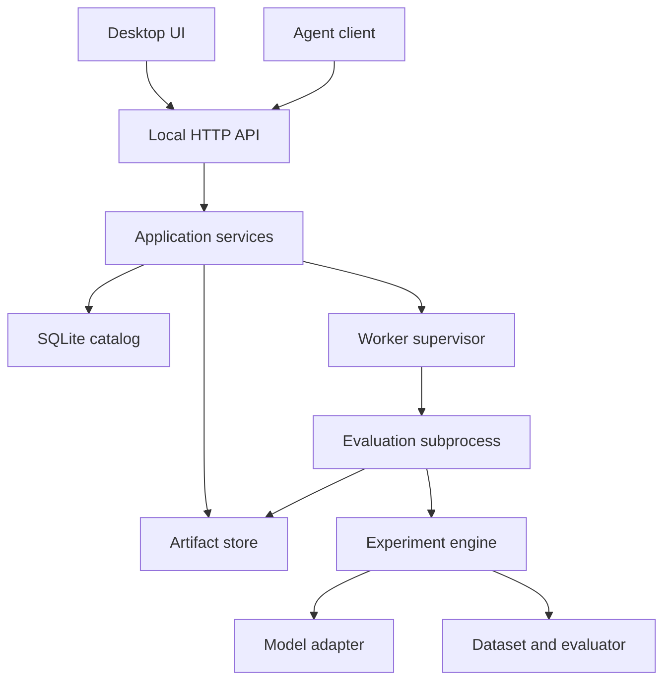
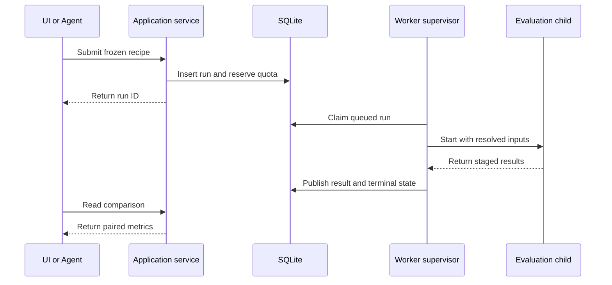

# LayerDelta — Architecture

The M2 implementation uses the [FastAPI transport](../../src/layerdelta/api.py), [SQLite supervisor](../../src/layerdelta/store.py) and [isolated workers](../../src/layerdelta/job.py). Each workspace has one supervisor, a queue and immutable published run directories. Both Windows CPU and NVIDIA CUDA execute the same adapter. The [desktop launcher](../../desktop/launcher.py) serves the React renderer from the API's loopback origin. The [typed Python client](../../src/layerdelta/client.py) uses the same request models as the HTTP service.

| Item | Details |
|---|---|
| Status | Implemented (v0.1, internal). The target design for v0.2+ is in [Architecture_Target](Architecture_Target.md); milestones are in the [Roadmap](../roadmap/Roadmap.md) |
| Date | 22 November 2026 |
| Scope | Local-first, single-user workspace, one PyTorch CNN architecture |
| Reference | [LayerDelta PRD v0.1](../history/LayerDelta_PRD_v0.1.md) |

## 1. Key decisions

Use a **modular monolith on the user's machine**. The backend owns the experiment recipes, the job queue, access rights and measurement results. Model evaluation runs in a separate child process for each run. In v0.1, only one job runs at a time. The UI and the Agent call the same set of application services. The CLI in the PoC calls the runner through the same experiment contract.

| Part | Proposed choice for the MVP | Reason |
|---|---|---|
| Backend | Python, FastAPI and Pydantic | Uses the same runtime as PyTorch and shares schema validation between entry points |
| Inference | PyTorch CPU reference runtime | Defines the reference environment for replay and tests the example CNN |
| Desktop UI | Desktop shell wrapping a React + TypeScript + Vite renderer | Opens from an icon, uses the native workspace/file picker, and uses a single UI/API origin |
| Headless | Python CLI that starts the same backend | The Agent can run jobs without opening a window |
| Metadata | SQLite inside the local workspace | Transactions for run state, idempotency, quota and artifact publication |
| Artifacts | Filesystem for checkpoints and run results | Files can be read and passed on by referencing their hash and catalog metadata |
| Checkpoint | Safetensors for the initial import and child export | Uses a tensor-only contract and builds the architecture from a registered adapter |
| Agent | Example HTTP client and a client-side provider adapter | Works with local or frontier LMs, because the experiment runtime does not depend on any provider |

This list is an engineering proposal from the PRD. The CNN topology, dependency versions and timeout values are frozen per milestone.

## 2. System structure



| Part | Responsibility | Data boundary |
|---|---|---|
| HTTP API | Authentication, request parsing, error envelopes, progress polling | Accepts IDs and schema-validated recipes |
| Application services | Inspect, propose, enqueue, cancel, compare, import/export and final evaluation | Checks permissions and resolves fingerprints before sending work |
| Worker supervisor | Claims jobs, spawns the child, enforces timeouts, tracks exit and publishes results | Sends the resolved execution plan to the child |
| Experiment engine | Builds the working model, applies interventions, runs batch inference, stores prediction records | Receives a validated recipe and checks the actual results during execution |
| Model adapter | Builds the architecture, checks the state dictionary, identifies layers and maps targets | Can only be called for adapters installed with the program |
| Dataset / Evaluator | Resolves the sample manifest, applies transforms, checks pairing and computes metrics | Uses sample IDs, labels and prediction records |
| Artifact store | Imports, hashes, stages, commits and reads files according to the catalog | Accepts paths from internal systems and uses the configured storage root |
| SQLite catalog | Stores metadata, references, job transitions, quota and audit | The supervisor and API are the only writers of persistent data |

**Dependency rule:** the schemas and the experiment core can be used from the CLI and tests without importing HTTP, the UI or SQLite. The adapter handles model-specific PyTorch details. The evaluator takes prediction records, so it can be tested with small synthetic data.

### Desktop and headless lifecycle

Use LayerDelta as the app name, and `layerdelta` as the repository and CLI name.

- Electron is the proposed default for the packaging spike. The renderer loads the UI that the backend serves from loopback. An isolated preload is used only where needed for the workspace picker. The main process starts a Python sidecar from an executable bundled with the app.
- The sidecar binds to loopback and announces its port only after it is ready to accept work, through a private startup channel. When the shell opens a workspace, it bootstraps a one-time human session and then uses a same-origin session. The headless CLI uses the same startup flow for the runtime. It shows the endpoint and keeps credential issuance separate from the logs.
- The backend holds the workspace lock for the whole session. The desktop and the CLI share one backend through an endpoint the user can configure. If another instance has locked the workspace, report the conflict clearly. When the desktop closes, it sends a shutdown command only to the sidecar it owns. Workers stop according to the lifecycle, and queued jobs are kept.
- The packaging spike must verify installation on the target OS, finding the sidecar from the installed package, opening a workspace whose path contains spaces or Thai characters, and restarting after an interruption. The choice of shell and target OS is locked after the spike.
- The MCP bridge is follow-up work. It calls the HTTP API with the Agent credential, using the same schema, quota and permissions. See [api.md](../reference/api.md) and [agent-integration.md](../guides/agent-integration.md).

## 3. Model adapter contract

The adapter registry uses the pair `architecture_id` and `architecture_revision`, which the system knows. `adapter_version` identifies the revision of the mapping and of how inputs are checked. One built-in CNN is registered in v0.1.

| Capability | Input and output |
|---|---|
| Build model | Creates a new model instance from a known architecture revision |
| State schema | List of parameters/buffers, shapes and allowed dtypes, for strict loading |
| Describe | Layer IDs, confirmed topology, shapes and labels for the UI |
| Resolve activation target | Target ID + channel → module reference, output selector, expected rank, channel axis and hook position |
| Resolve kernel target | Target ID + channel → parameter name, expected shape, index along the output axis and expected dtype |
| Capture preview | Sample ID, target and checkpoint → weight statistics or an activation map, linked to its provenance |

Example mapping for the reference CNN. The real names are confirmed in M0.

| Target ID | Location | Mapping |
|---|---|---|
| `features.block2.relu.output` | After the ReLU of block 2 | Output `[N, C, H, W]`, select `[:, c, :, :]` |
| `features.block2.conv.kernel` | Conv kernel of block 2 | Weight `[C_out, C_in/groups, K_h, K_w]`, select `[c, :, :, :]` |

The engine checks rank, dtype and index bounds at run time. For the CNN fixture, the target module that has the hook attached must be called exactly once per forward pass. If an invocation is found that violates the contract, the run fails. This prevents measurements from being taken with an intervention applied at the wrong position. The UI shows the layer relationships and hook positions from the same catalog that the engine uses.

### Loading a checkpoint

1. Check the file size and the header size against the caps before materializing any tensors.
2. Read the metadata from Safetensors and match the key set, shapes and dtypes against the state schema, including buffers. Check that the number of bytes matches what the architecture expects.
3. Compute the SHA-256 of the stored file. Use the copy inside the workspace as the reference.
4. Build the model with the built-in adapter, then strictly load it in the worker. Check that every floating-point tensor is finite, and call `eval()` before inference.
5. Return the checkpoint ID from the catalog, so the API uses it instead of the user's file name or path.

Child files use the same contract and are loaded back through the same process. A rejection gives the reason, naming the related field or parameter.

## 4. Recipes and artifact identities

| Identity | Data used |
|---|---|
| Recipe ID | ID of an immutable revision, used to reference it in the workspace |
| Recipe hash | SHA-256 of the canonical JSON of a frozen recipe. It covers the hypothesis, model/dataset provenance, evaluation config and the intervention |
| Evaluation fingerprint | Hash of the source checkpoint, architecture/adapter revision, dataset/split/manifest, preprocessing and evaluator revision, the execution settings that affect predictions, and the runtime identity |
| Run ID | ID of one submission. Retries and replays are included, and each one gets a new run ID |
| Artifact hash | SHA-256 of the bytes in a checkpoint, manifest or result file referenced in the catalog |

Canonical encoding uses UTF-8 and a shared schema version. Object keys are sorted. NaN and Infinity are rejected, and numeric fields are normalized according to the schema. Run IDs, timestamps, absolute paths and queueing data are stored in the run metadata, outside the recipe hash. The recipe hash uses golden fixtures for export and import, to confirm that the hash is stable across workspaces. When a recipe is imported, its dependencies are resolved by fingerprint, and any items that cannot be found are reported before the run is allowed to start.

Example of the data the engine uses for an activation intervention:

```json
{
  "mode": "activation",
  "target_id": "features.block2.relu.output",
  "channel_index": 17,
  "operation": "scale",
  "scale": 0.5
}
```

This example shows only the intervention part of a recipe. The full schema is in PRD §7. The checkpoint path and the pointer to the hook are resolved inside the runtime.

## 5. Processing one run



1. The service checks the actor, project, split permission, recipe hash and dependencies. A repeated request with the same idempotency key and the same payload returns the same run ID. A request that reuses a key with a different payload returns a conflict.
2. The service records the run, the idempotency record and the quota charge in one transaction. The supervisor claims the job with a conditional update from `queued` to `running`.
3. The supervisor resolves paths, runtime settings and the baseline candidate for the child from the pinned manifest. The child checks the checkpoint digest and the sample manifest before running.
4. The child reads a baseline with a matching fingerprint, in full, or computes the baseline with a new model instance. The child builds another working model instance for the intervention. Inference mode is used in both phases.
5. **Activation:** attaches a forward hook only to the resolved target, clones the output tensor, modifies the slice for the channel, and returns a tensor with the original shape and dtype. The hook is removed in a `finally` block, and the process exits when the run ends.
6. **Weight:** modifies one Conv kernel slice under no-grad before inference starts. Checks that the values are finite, and records the parameter name, the slice and the statistics before and after. The bias and the remaining tensors keep their original values.
7. **Zero and scale:** zero uses assignment of zero. Scale multiplies by a validated value. The proposed range is [0, 2]. A fixture confirms that scale = 0 gives the same result as zero, and that scale = 1 gives predictions identical to the baseline on the reference runtime.
8. The child writes its results to the run's staging area. The supervisor checks completeness and publishes them before the API reads the results. If a baseline had to be built, it is recorded as a baseline record with an ID and its measurements, so that intervention runs can refer back to it.

The Model Explorer uses a preview command through the service and a worker to run inference on a single image, without creating an experiment run. The size of the activation map output is limited. The cache is keyed by checkpoint + target + sample + preprocessing fingerprint. A preview is a short job in the queue of a single worker, to control resource use.

## 6. Dataset and paired evaluation

- Train, exploration and final holdout splits are created from the source sample IDs before the normal and blurred variants are generated. The manifest records `sample_id`, `source_sample_id`, `split`, `condition`, `label`, the source digest and the transform version and parameters.
- The dataset loader returns samples in a fixed order, checks that sample IDs are unique, and checks that source IDs do not overlap across splits. During fixture preparation, the digest of the source dataset and of the preprocessing manifest are recorded.
- Prediction records store `sample_id`, ground truth, predicted class and condition. Additional scores can be stored when the schema gives their name and version.
- Pairing uses the sample ID, and also checks that the label, split and condition match. If even one item is missing or duplicated, the comparison fails, so that the denominator stays the same.
- In v0.1, the overall result is proposed as a micro-average over the selected sample-condition rows. Normal and blurred are shown separately, each with its N. For slices defined by the baseline, membership is stored by referring to the baseline run. The primary holdout slice uses the rule that was frozen before the set was opened.
- The evaluator produces common counts and metrics. The UI, the API and the JSON export all read from the same data. Accuracy deltas are in percentage points. The confusion matrix uses the ground truth as rows. An empty slice returns N = 0, with the metric set to null.
- The runtime metadata records the Python and PyTorch versions, device, dtype, thread and determinism settings, batch size and seed, as actually used. The replay criterion in the first release uses the predicted classes and the integer counts on the reference runtime. The tolerance for floating-point diagnostics is frozen from M1.

## 7. Persistence, commit and recovery

| Data group | Where stored | Rule |
|---|---|---|
| Projects, checkpoint catalog, dataset catalog | SQLite | References the manifest and the verified digests |
| Recipes | SQLite | Immutable revision with canonical JSON and recipe hash |
| Runs, quota, idempotency, holdout audit | SQLite | Transactions and constraints for state transitions and uniqueness |
| Checkpoints, split manifests | Filesystem | Immutable files referenced from the catalog |
| Predictions, comparison, result manifest | Filesystem | One result declaration per run, with checksums for each file |
| User export | Filesystem | Destination name from the system or from a user-selected export flow, with no-overwrite semantics |

Proposed workspace layout:

```text
workspace/
  catalog.sqlite3
  checkpoints/<sha256>.safetensors
  datasets/<dataset-id>/<revision>/
  runs/<run-id>/
    manifest.json
    predictions.jsonl
    comparison.json
  staging/<run-id>/
  exports/<artifact-id>/
```

**Publish protocol:** all files are written to a staging area on the same filesystem as the destination. The manifest and digests are checked, then the files are flushed and published to a run-specific destination name. Next, the catalog reference and the `succeeded` status are committed in one transaction. Users read results only through the committed catalog. If a crash happens after the files are published but before the commit, those files are treated as orphans that the API cannot see. On startup they are checked against the catalog and cleaned up. If the manifest of a successful result is missing or a digest is wrong, report an artifact error and remove that result from the baseline cache.

**Lifecycle:** `queued → running → succeeded | failed | cancelled`, and `queued → cancelled` is also allowed. A cancel during a run records a cancel intent. The supervisor tells the child to stop at the next batch boundary, and ends the process if it exceeds the grace period. During publication, a transaction decides the outcome together with the cancel intent. If the cancel is recorded before the success commit, the run ends as cancelled and the staging area is not opened. If the success commit happens first, the existing terminal status is kept. A timeout ends as `failed` with a code, and no partial results are kept for comparison.

**Restart and retry:** a single-instance workspace lock prevents two supervisors from running at once. On restart, orphaned children are cleared according to the supervisor's lifecycle. Jobs that were `running` when the process was interrupted become `failed` with a reason. Queued jobs and their recorded quota are kept. A retry is a new run that references `retry_of_run_id`, and it is charged under the same rules as a normal request. The proposed default is to count quota when a job is accepted, and to also count jobs that are cancelled or fail. Errors rejected before enqueue, and idempotent retries, are not charged again.

## 8. Agent, holdout and checkpoint export

| Action | Human UI | Agent credential |
|---|---|---|
| Inspect / preview exploration | Allowed | Only the exploration data that has been enabled |
| Propose / run exploration / compare | Allowed | Only the project and session that were granted, with quota |
| Progress / cancel | Jobs in the workspace | Jobs that the session was granted |
| Final evaluation and reading holdout results | Confirms the frozen recipe through the UI | Fully restricted, including sample preview, history, compare and cache lookup |
| Checkpoint export | Confirmed from a successful weight run | Fully restricted |

The API binds to loopback by default and serves the UI same-origin. It checks Host and Origin according to the transport. The human UI and the Agent use separate sessions/tokens. Permissions are checked at the service on every request. For cookie-based UI, CSRF protection is applied to state-changing requests. The Agent token is limited to one project and one session, is stored in the local client config, and is redacted from logs. The default quota in the PRD is 10 runs per session for the pilot. The local runtime works without connecting an LLM.

**Holdout:** when the service accepts a final evaluation request, it creates an audit event with the recipe hash and the manifest hash. The history of holdout openings is shown to the user. This separation of data applies to the LayerDelta services on the machine. Anyone who has direct access to the workspace files has the normal rights of the operating system.

**Checkpoint export:** loads the parent from its original digest, uses the same weight-patch implementation as the run, and serializes the child tensor-only. It writes a manifest with the parent SHA-256, child SHA-256, recipe hash and source run ID. The export must reference the runtime and adapter revision of the source run. It tests that the child loads and runs without any intervention, and compares the result with the source run. It also checks that the tensor diff is limited to the slice that was specified. Activation interventions are stored as recipes and measurements in their own format.

## 9. API boundary and observability

| Operation | Behavior that must stay fixed |
|---|---|
| Inspect | Returns the target catalog with revisions and lists the allowed operations |
| Propose / import | Returns schema errors with the field path, and reports dependency mismatches |
| Run / status / cancel | Run returns an ID immediately. The UI polls, reporting the phase and the completed batches when the total is known |
| Compare | Returns only published results. Supports paging through the list of changed predictions |
| Export | Uses artifact IDs and filenames controlled by the system, and communicates the outcome of retries |
| Errors | Each error has a machine-readable code, a message for the UI, and a correlation ID that also appears in the log |

Record the run ID, actor type, recipe hash, queue time, wall time, sample count, artifact bytes, worker exit and failure code, as far as they are needed to replay a run. Peak RAM, inference duration and the time to show a comparison are measured on the fixture from M1, to set a performance budget before beta.

## 10. Source layout and development plan

```text
src/layerdelta/
  domain/          # Schemas, fingerprints, run and recipe rules
  adapters/        # Registry and reference CNN
  engine/          # Inference, activation hooks, kernel patch, runner
  evaluation/      # Dataset manifest, preprocessing, paired metrics
  application/     # Inspect, propose, run, compare, export
  infrastructure/  # SQLite, artifact store, supervisor
  api/             # HTTP transport and authentication
  cli/             # PoC runner and local commands
web/               # React desktop renderer
examples/agent/    # Local HTTP client example
tests/fixtures/    # Controlled CNN and prediction fixtures
```

The v0.1 milestones below are complete. M4 produced an internal release candidate. Publication is parked (see the [Roadmap](../roadmap/Roadmap.md)).

| Milestone | Development order | Evidence required before passing |
|---|---|---|
| M0 · Reference fixture | Define the topology, adapter target mapping, source split, preprocessing and checkpoint schema | Manifest is pinned and samples can be opened |
| M1 · Runner | Build the loader, adapter, baseline, hooks/patch, evaluation and CLI JSON | G2–G5 on the fixture, including the scale identity, bias case, and a baseline after failure/cancel |
| M2 · Product alpha | Add the catalog, supervisor, API, desktop shell, headless CLI, replay and checkpoint export | G1/G6/G7 work through the real workflow, including re-importing a child checkpoint |
| M3 · Beta | Add fault injection at the commit boundary, quota/idempotency concurrency tests and holdout tests | G8/G9 pass, and the benchmark/pilot is recorded |
| M4 · Release | Package the desktop app and headless CLI, quickstart, Agent example and adapter guide | G10, including confirmation of the license and the right to distribute the artifacts |

The priority in M1 is to run **baseline → activation → weight → baseline** with evidence at the sample and tensor level, before moving on to the UI. After v0.1 is complete, adding an architecture from a second family will test the flexibility of the adapter contract. OCR changes the evaluation contract according to the task type. Dynamic dropout uses a separate training workflow, according to the PRD roadmap.

## 11. Decisions to lock before each stage starts

| Decision | Owner by task | Decided at |
|---|---|---|
| CNN topology, layer IDs, MNIST fixture and blur parameters | Model / Evaluation | M0 |
| Tensor format caps, runtime versions and tolerance | Engine | M0–M1 |
| HTTP paths and request/response schemas | Backend | Before M2 |
| SQLite schema, migrations and retention of staging/orphans | Backend | Before M2 |
| Quota, timeout, queue cap and performance thresholds | Backend / Product | Before M3 |
| Code license and the right to distribute checkpoints/datasets | Project owner | Before M4 |
