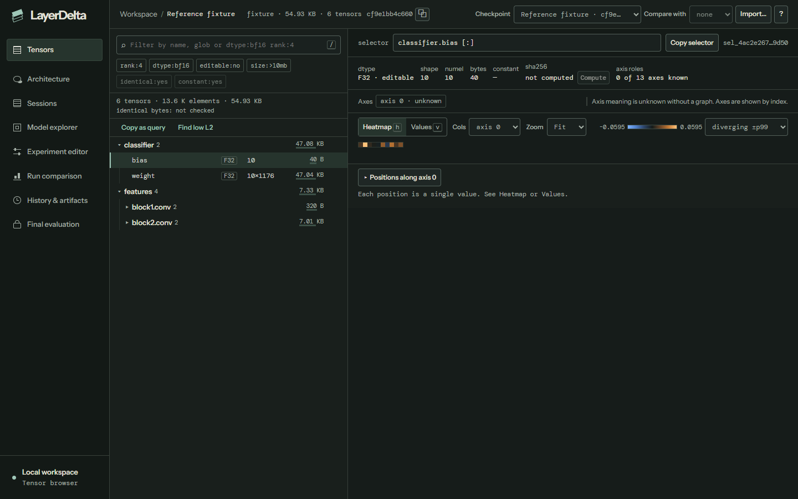
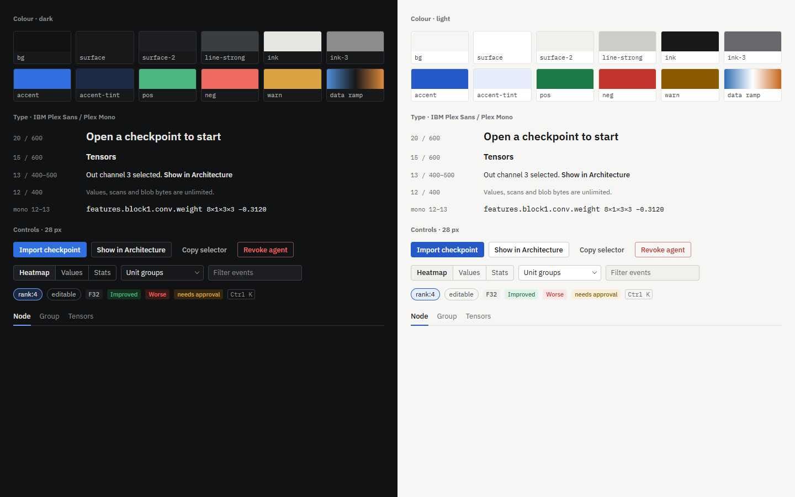
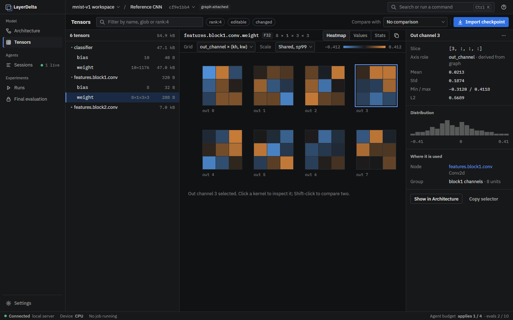
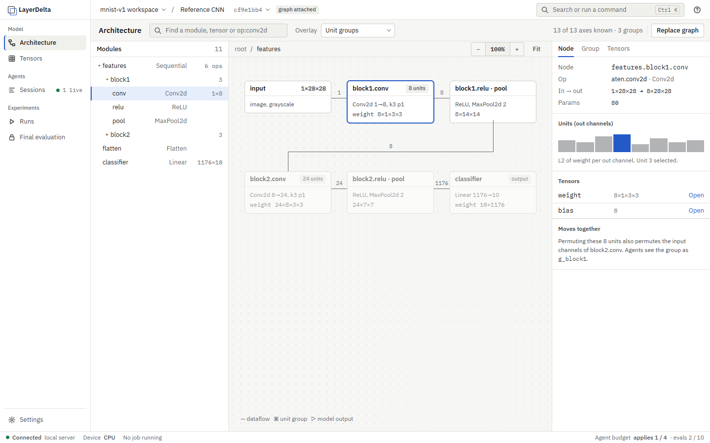
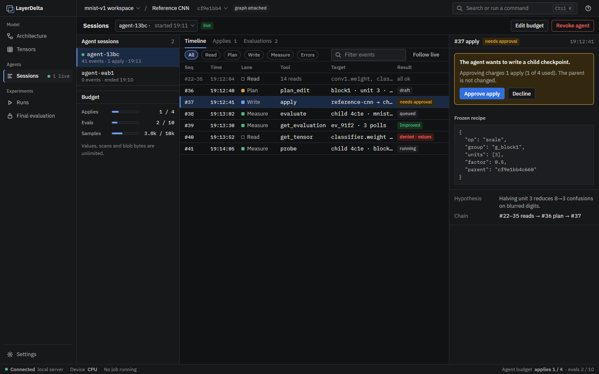
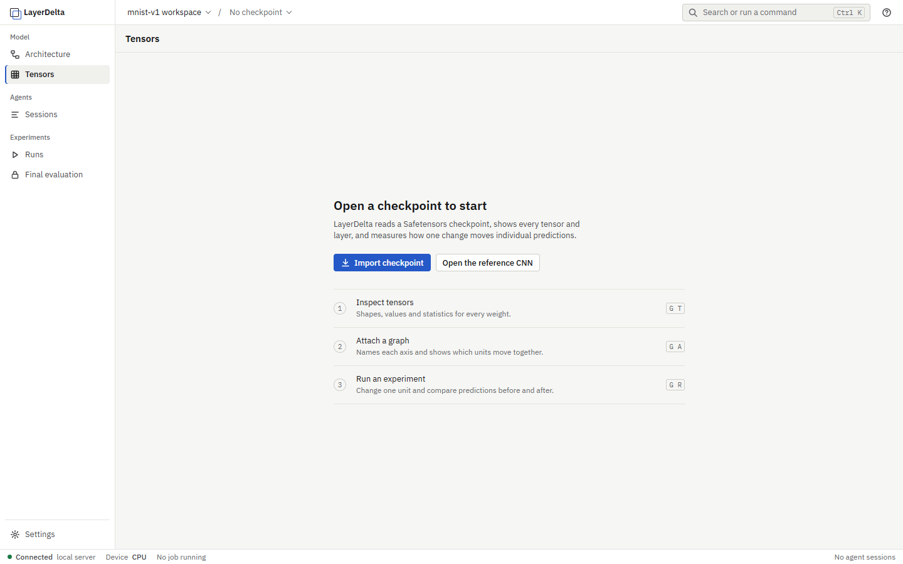

# Desktop redesign v1: audit, direction, tokens and plan

Status: **proposed, rev 1**. Owner: UX/UI design. Implementation: Frontend Developer. Technical review: AI Scientist.
Mockup: [`redesign-v1-mockup.html`](redesign-v1-mockup.html). Open it with `?b=tensors`, `?b=arch`, `?b=sessions`, `?b=start` or `?b=tokens` to see one board. Renders of each board are in `screens/redesign-v1-*.png`.

This spec changes how the app looks and how it is organised. It does not change any route, payload, capability or agent rule. The screen specs stay in force for behaviour: [tensor-browser.md](tensor-browser.md), [architecture-navigator.md](architecture-navigator.md), [session-trace-viewer.md](session-trace-viewer.md) and [session-evaluations.md](session-evaluations.md). Where this spec and an older visual detail disagree, this spec wins. Where they disagree on behaviour, the screen spec wins.

## 1. Why

The owner finds the desktop app hard to use and says it looks generic and AI-made. The audit below agrees with both points. The main cause is not one bad screen. Each screen was built to its own spec with its own palette, header and controls, and the app grew into two products in one window: the v0.1 experiment wizard and the v0.3–v0.5 inspection and supervision tools.

## 2. Audit

Captured on 2026-11-24 from a fresh worktree off `origin/main` (b86ea19), with the built renderer and a local server on a copy of the desktop validation workspace, in headless Edge at 1440×900 and 1100×700. Captures: `screens/audit-v1-*.png`.

### 2.1 Hard to use



| # | Finding | Where | Capture |
|---|---|---|---|
| U1 | **Eight peer items in the nav, from two products.** Tensors, Architecture and Sessions sit next to Model explorer, Experiment editor, Run comparison, History & artifacts and Final evaluation. The last five are steps of one experiment, shown as if they were separate places. A new user cannot tell where to start. | rail | `audit-v1-explorer.png` |
| U2 | **The checkpoint picker moves and changes between screens.** Model explorer: "Checkpoint" with a bare hash `cf9e1bb4c660` and a device picker. Tensors: "Reference fixture · cf9e…" next to Compare with, Import and Help. Architecture: the same picker with a second status row. Sessions: no picker, budget meters instead. The one global choice has no fixed home. | context bar | all |
| U3 | **No clear primary action.** Tensors shows Import…, Copy selector, Compute, Copy as query and Find low L2 at the same weight. Sessions shows four Edit buttons and Revoke… in the header beside the meters. Architecture's one strong button (Attach graph) is a full-width mint bar. | headers | `audit-v1-tensors.png`, `audit-v1-sessions.png` |
| U4 | **Empty space where the answer should be.** A 10-value bias draws an 80 px strip and leaves 600 px empty. The Architecture inspector says only "Select an operation…" in a full-height column. A session with no requests still shows every filter, a Live tail button and column headers. | panes | `audit-v1-tensors.png`, `audit-v1-architecture.png`, `audit-v1-sessions.png` |
| U5 | **Words from the implementation, not the task.** "Class 0 · metadata only", `sel_4ac2e267…9d50`, "identical bytes: not checked", "13 of 13 axes derived (100.0%) · 0 opaque · 3 open groups", "The trace records IDs. Opening a tensor reads it as you (human session)." All true, but none tell the user what to do next. | everywhere | |
| U6 | **No first run.** Nothing says what LayerDelta does or what to do first. The app opens on Model explorer, which starts computing a channel preview right away. | start | `audit-v1-explorer.png` |
| U7 | **Inconsistent and leaking error states.** Without a session, Tensors shows a clear alert with Retry, Experiment editor and Run comparison hang on "Connecting…" over a blank page, and Final evaluation prints the raw script error *"Cannot read properties of undefined (reading 'project_id')"*. | no session | `audit-v1-raw-error.png` |
| U8 | **Important ids are cut in the worst place.** `agent-13bc…`, "Reference fixture · cf9e…", "phase2-inspect-corpus ed…": the part that tells two items apart is the part that is cut. | lists, pickers | |
| U9 | **The canvas starts unreadable.** At Fit, Architecture node text is about 9 px, and most of the canvas and the minimap are empty. | Architecture | `audit-v1-architecture.png` |
| U10 | **Help is hidden.** Shortcuts exist (`/`, `h`, `v`) but appear only as tiny key caps. Help is a "?" button in a different place on each screen. | headers | |
| U11 | **At 1100 px the frame wastes width.** The 198 px rail and the 78 px logo block stay fixed, and the header compresses the checkpoint name to "Reference fixture …". | narrow | `audit-v1-narrow.png` |

### 2.2 Generic or AI-made

| # | Finding | Why it reads as generic |
|---|---|---|
| G1 | **Mint accent on green-black**, with every surface tinted green (`#161c1a`, `#9fc7b8`). | It is the default "dark dev tool" palette. It also makes every surface look the same, so nothing stands out. |
| G2 | **Monospace used as decoration.** Section labels ("Agent sessions", "Live", "selector"), filter chips, breadcrumbs and the footer are all set in DM Mono, as well as the real values. | Mono stops meaning "this is a value you can copy", and the whole UI looks like a terminal theme. |
| G3 | **Landing-page headings in a tool.** "Model explorer", "Experiment editor" and "Final evaluation" are 48–54 px with tight negative tracking, over cards titled at 24 px. | Display type that belongs on a marketing hero, repeated on every page, pushes the work below the fold. |
| G4 | **Generic card grid.** Model explorer, Experiment editor and Final evaluation are bordered cards with a big title and a few fields each, side by side. | This is the template layout the owner calls slop. The cards do not match the shape of the task. |
| G5 | **One-off visual systems.** The CSS has **120 distinct hex colours, 43 font sizes, 10+ border radii** and six screen-local token sets (`--bench-`, `--tv-`, `--an-`, `--tb-`, `--cmp-`, `--p-`). | Small differences between screens add up to an app that looks assembled rather than designed. |
| G6 | **Hand-drawn CSS nav glyphs** of different weights and sizes next to a large logo block. | Each glyph looks fine alone, but together they look improvised. |
| G7 | **Filler sentences** that explain the system rather than the task (U5). | Long, even-toned explanations everywhere are a sign of generated copy. |

### 2.3 What works and stays

- The data views: tensor heatmaps with a shared diverging scale, the per-position table, the group overlay, the timeline lanes, read bursts and the provenance chain.
- The three-pane split (list, main view, inspector) on all three new screens.
- Keyboard-first details: `/` to search, single-key view switches, URL state for every selection.
- Honest wording rules from the screen specs: no "significant", "unknown" kept as unknown, pixels and values shown to the human only.

## 3. Direction: an instrument, not a dashboard

LayerDelta is a measuring instrument for one model at a time. The interface should feel like a good lab instrument or an IDE: quiet, dense, the same frame everywhere, and colour used only when it means something.

Seven rules, used to settle every later question:

1. **One frame for every screen.** Top bar, rail, screen toolbar, panes, status bar. Learn it once (§3.1).
2. **One global context.** The workspace and checkpoint live in the top bar and nowhere else. Every screen reads them.
3. **One primary action per screen**, at the right of the toolbar, in the accent fill. Everything else is secondary, ghost or in a ⋯ menu. Destructive actions are red outline and stand apart.
4. **Mono means value.** Mono is only for things you could copy: names, ids, shapes, numbers, selectors and JSON. All labels and sentences are in the sans.
5. **Colour means state.** Neutral greys carry the layout. Accent blue means selected, focused or the primary action. Green, red and amber mean improved, worse or failed, and needs attention. The data ramps are kept for data only.
6. **Every empty pane says what goes there and how to fill it**, in one sentence and with one action. No empty column, and no control that cannot do anything yet.
7. **Words for the task.** Labels name the thing ("Out channel 3", "Budget", "Needs approval"). Implementation detail moves into tooltips and the inspector's details.

What we took from the reference galleries (principles, not layouts):

| Source | What works there | How it maps to LayerDelta |
|---|---|---|
| navbar.gallery | Product shells with a short grouped sidebar, a collapse control and one strong action. The weak examples are mega menus with many equal links. | The rail groups its items under Model, Agents and Experiments, with five places in total (§3.2). It collapses to icons at narrow widths. One primary action per toolbar. |
| heroinspo.com | The strong heroes say one plain sentence, offer one action and show the real product, not a mood image. | The first run (§6.4) is one sentence and one primary action (with a secondary for the reference model), and three short steps show the actual workflow. Empty panes follow the same pattern. |
| cta.gallery | The CTAs that work are a verb and an object, put where the user already is ("Claim your handle" inside its own field), with strong contrast and one per view. | Buttons say a verb and an object: *Import checkpoint*, *Approve apply*, *Show in Architecture*. The action sits next to what it acts on (the approval card holds Approve and Decline). |

What we do not take: gradient grounds, glass, big hero type, photo or illustration fills, carousels, card grids, emoji, and marketing copy. The kit and gate of the `design-taste-frontend` skill are for marketing pages and do not apply to a desktop tool. We kept its "one system" rules: one button pair, one radius scale, one heading scale, verb-and-object buttons and no filler words. `ui-ux-pro-max` was used for its accessibility and density rules (4.5:1 contrast, visible focus, no emoji icons, dense spacing). Its generated "dev tool" palette (slate with a run-green) was rejected: it is the generic look we are moving away from. The `frontend-design` skill is not installed in this environment.

### 3.1 The frame

```
┌──────────────┬─────────────────────────────────────────────────────────────────────────────┐
│ LayerDelta   │ mnist-v1 workspace ▾ / Reference CNN cf9e1bb4 ▾ [graph attached]   [Search… Ctrl K] (?) │  top bar 40
├──────────────┼─────────────────────────────────────────────────────────────────────────────┤
│ Model        │ Tensors  [filter…] (rank:4)(editable)        Compare with [none ▾] │ [Import checkpoint] │  toolbar 44
│  Architecture├──────────────────┬──────────────────────────────────────┬───────────────────┤
│ ▌Tensors     │ list / outline   │ main view                            │ inspector         │
│ Agents       │ pane header 32   │ pane header 32                       │ pane header 32    │
│  Sessions ●1 │ rows 28          │                                      │ sections          │
│ Experiments  │                  │                                      │                   │
│  Runs        │                  │                                      │                   │
│  Final eval. │                  │                                      │                   │
│ ──────────── │                  │                                      │                   │
│  Settings    │                  │                                      │                   │
├──────────────┴──────────────────┴──────────────────────────────────────┴───────────────────┤
│ ● Connected local server   Device CPU   No job running           Agent budget applies 1/4 · evals 2/10 │  status 24
└────────────────────────────────────────────────────────────────────────────────────────────┘
```

- **Top bar (40 px).** The product mark, then the context: the workspace switcher, then the checkpoint switcher, which shows the **display name in full and an 8-character hash** (U8) plus a "graph attached" tag. On the right: the command search (phase 6; until then the field is not shown) and Help.
- **Rail (184 px, 52 px collapsed).** Grouped places (§3.2). The live-session dot and count sit on Sessions. Settings (theme, density, shortcuts) is at the bottom. Below 1200 px the rail collapses to icons with tooltips; the user can pin it open.
- **Screen toolbar (44 px).** Screen title (15 px), the screen's view controls, then on the right the screen's own secondary controls and **its one primary action**.
- **Panes.** Up to three: list (240–320 px), main, inspector (300–360 px). The list and inspector can be resized and collapsed (`[` and `]`). Each pane has a 32 px header with its title and count.
- **Status bar (24 px).** Connection, requested device (click to change; it moves here from the Model explorer header), the running job with Cancel, and an agent budget summary (click to open Sessions › Budget). Facts the user glances at, out of the way of the work.

### 3.2 Places

| Group | Place | Was | Notes |
|---|---|---|---|
| Model | Architecture | Architecture | unchanged behaviour |
| Model | Tensors | Tensors | unchanged behaviour |
| Agents | Sessions | Sessions | Timeline, Applies and Evaluations tabs (E9). The budget moves from the header into the session list pane (§6.3). |
| Experiments | Runs | Model explorer, Experiment editor, Run comparison, History & artifacts | One place: the run list on the left, and on the right either the new-run composer (sample, channel preview, intervention, hypothesis) or the selected run's comparison. Phase 1 groups the four old screens under Runs as sub-views; phase 5 merges them (§7). |
| Experiments | Final evaluation | Final evaluation | Kept as its own guarded place with a lock icon, because holdout is human-only and audited. Behaviour unchanged. |

URLs keep working: `?screen=tensors`, `architecture` and `sessions` stay. The old screen names map to `?screen=runs&view=explore|edit|compare|history`.

## 4. Tokens

All colour, type, spacing and radius values live in one file, `desktop/src/tokens.css`. Components use only the semantic names below. No hex literal appears outside `tokens.css` except in the data ramps, which keep their own file. The two themes swap values, not names.

### 4.1 Colour



| Token | Dark | Light | Use |
|---|---|---|---|
| `--bg` | `#111214` | `#f6f6f4` | app ground, main pane |
| `--surface` | `#17181a` | `#ffffff` | rail, top bar, status bar, list and inspector panes, controls |
| `--surface-2` | `#1d1e21` | `#f0f0ed` | inputs, segmented "on", meters' track |
| `--raised` | `#24262a` | `#ffffff` | menus and popovers (with `--shadow`) |
| `--line` | `#2b2d31` | `#e3e3df` | pane borders, row rules |
| `--line-strong` | `#3a3d42` | `#cdcdc8` | control borders |
| `--ink` | `#e6e6e3` | `#17181a` | primary text |
| `--ink-2` | `#b0b1ae` | `#45474a` | secondary text, idle nav |
| `--ink-3` | `#8b8d8b` | `#66686b` | labels, captions, metadata |
| `--accent` | `#6ea0ff` | `#2459c7` | links, focus, selected marker |
| `--accent-fill` / `--on-accent` | `#2f6fe0` / `#fff` | `#2459c7` / `#fff` | primary button, active chip |
| `--accent-tint` | `#1b2a44` | `#e6eefc` | selected row, active chip ground |
| `--pos` / `--pos-tint` | `#4cb782` / `#16301f` | `#1d7a46` / `#e4f3ea` | Improved, succeeded, live |
| `--neg` / `--neg-tint` | `#ef6a62` / `#3a1a18` | `#c2352d` / `#fbe7e5` | Worse, failed, denied, destructive |
| `--warn` / `--warn-tint` | `#d9a441` / `#33280f` | `#8a5b00` / `#f8efdc` | needs approval, Plan lane, stale |
| `--focus` | `#8db6ff` | `#2459c7` | 2 px focus ring, 2 px offset |

Measured contrast (WCAG 2.x): `--ink-3` on every ground is 4.9:1 or more in both themes. `--accent` on `--bg` is 7.3:1 (dark) and 5.8:1 (light). White on `--accent-fill` is 4.7:1 (dark) and 6.3:1 (light). Each state colour on its own tint is 4.6:1 or more. Colour is never the only signal: tags carry words, lanes carry names and shapes, and the reading word is always printed.

**Data colours are separate.** The tensor diverging ramp (negative blue, zero at the ground, positive orange), the delta ramp and the categorical overlay colours stay as defined in the screen specs. Their zero colour follows `--bg` in each theme. Selection on a data view is drawn as an `--accent` outline, never as a fill, so it does not change a value's colour.

**Theme.** By default the app follows the OS setting (`prefers-color-scheme`, which WebView2 passes through). Settings › Theme offers System, Dark and Light. Dark is the design reference: long sessions, heatmaps on a dark ground.

### 4.2 Type

Faces: **IBM Plex Sans** (400, 500, 600) and **IBM Plex Mono** (400, 500), both SIL OFL 1.1. They are bundled as `woff2` with their licence in `desktop/public/fonts/`, as Instrument Sans and DM Mono are today; no network fonts. We chose them because they are drawn for interfaces at 12–13 px, have tabular figures and a clear zero and one, and the sans and mono share metrics, so a value in a sentence sits on the same line.

| Token | Size / line | Weight | Use |
|---|---|---|---|
| `--t-20` | 20 / 26 | 600 | first-run heading only |
| `--t-15` | 15 / 20 | 600 | screen title in the toolbar |
| `--t-13` | 13 / 18 | 400, 500 | **base**: UI text, rows, buttons (500), pane titles (500) |
| `--t-12` | 12 / 16 | 400, 600 | metadata, captions, section titles in the inspector (600) |
| `--t-11` | 11 / 14 | 500 | rail group labels, key caps |
| mono 13 / 12 | 13 / 18, 12 / 16 | 400 | values, ids, shapes, numbers, JSON; `font-variant-numeric: tabular-nums` |

There are no other sizes. Letter spacing is 0 everywhere, with no negative display tracking. Headings use sentence case. Text is never smaller than 11 px, and running text is never smaller than 12 px.

### 4.3 Space, size, shape, motion

- **Spacing** on a 4 px base: `--s1` 4, `--s2` 8, `--s3` 12, `--s4` 16, `--s5` 24, `--s6` 32. Pane padding is 12. Gaps between controls are 8.
- **Heights:** control 28 (compact 24 in dense tables), row 28, pane header 32, toolbar 44, top bar 40, status bar 24. The app is mouse-and-keyboard, so the 44 px touch rule does not apply. Every target is at least 24×24 (WCAG 2.5.8), with 8 px between icon buttons.
- **Radius:** 4 for controls, 6 for popovers, cards and canvas nodes, 0 for panes. Chips are fully round (height / 2). There are no other radii.
- **Borders and elevation.** Panes are split by 1 px `--line`. Only menus and popovers have a shadow. No gradients, glass, blur or glow.
- **Motion.** 120 ms ease-out for hover and press. 160 ms for a pane opening or closing. No entrance animation, scroll effect or looping motion, except the live dot (a static dot; it does not pulse). Everything respects `prefers-reduced-motion`.
- **Icons.** One 16 px stroke set (1.5 px, round caps), drawn to one grid; the mockup draws the set inline. Every nav icon has a visible label, and icon-only buttons have a tooltip and an accessible name. No emoji.

## 5. Components

One of each. They live in `desktop/src/ui/` (or in a shared stylesheet if fe-dev prefers), and every screen uses them.

| Component | Variants | Rule |
|---|---|---|
| Button | primary, secondary, ghost, danger; with an optional leading icon; icon-only (square) | One primary per screen. The label is a verb and an object. Danger opens a confirm step. |
| Select | default; in the top bar it is borderless until hover | Shows the full value; truncates in the middle (`phase2-insp…corpus edit`), never at the end, where the distinguishing part is. |
| Text field | default, with a leading search icon, with a key-cap hint | The label is visible (or set as `aria-label` in a toolbar search). |
| Segmented control | 2–4 options | Switches views of the same data (Heatmap, Values, Stats). |
| Tabs | underline | Switches content in a pane (Node, Group, Tensors; Timeline, Applies, Evaluations). |
| Chip | toggle filter | Filters a list. It is round, so it does not look like a tag. |
| Tag | neutral, pos, neg, warn | Shows a state on a row. Square corners, 11 px, always a word. |
| Key cap | — | Shortcut hints, mono 11 px. |
| Pane header | title, count, right-hand tools | 32 px. |
| Tree / table rows | default, hover, selected | 28 px; selected = `--accent-tint` with a 2 px accent marker on the left. |
| Inspector section | title, key–value list, note | The title is 12/600 in `--ink-2`. |
| Empty state | sentence, optional detail, one action | §6.5. |
| Banner | info, warn, error | Inside the pane it concerns, with an action (Retry). It never shows raw exception text; the request id goes in a details line. |
| Meter | label, bar, value | Budgets. The bar is `--accent` and turns `--warn` at 80 % and `--neg` when exhausted. |

## 6. Key screens

The renders are at 1440×900. Each one uses only the tokens and components above.

### 6.1 Tensor browser (`screens/redesign-v1-tensors.png`, dark)



- **Toolbar:** title; the filter field with chips for the common filters (rank, editable, changed). On the right: Compare with, then **Import checkpoint** (primary). Copy as query, Find low L2 and Compute hash move to the ⋯ menu of the list or inspector, where they apply.
- **List pane:** the tensor tree in modules. Names are mono, shape and size are mono in `--ink-3`, and the size column is right-aligned. The pane header reads "6 tensors · 54.9 kB". The "identical bytes" line appears only when Compare is on.
- **Main pane:** the header shows the tensor name, dtype tag, shape, the Heatmap/Values/Stats segmented control and Copy selector (icon). A second header row holds the view settings (grid layout, scale) and the legend. For a rank-4 conv weight, the heatmap shows **one small multiple per out channel** on one shared scale (the tensor spec already defines the mapping). For a small 1-D tensor (U4) it draws the cells at a readable size (at least 24 px per cell, wrapping) and puts the Values table directly under them instead of leaving the pane empty.
- **Inspector:** never empty. With a tensor selected it shows its stats, distribution and where it is used. With a slice selected (out channel 3) it shows the slice selector, axis role, stats, histogram, the node and group it belongs to, and **Show in Architecture**. The `sel_…` id is shown only in Copy selector's tooltip and in the details.

### 6.2 Architecture navigator (`screens/redesign-v1-arch.png`, light)



- **Toolbar:** title, the find field, Overlay. On the right, the graph status as one short sentence ("13 of 13 axes known · 3 groups") and **Replace graph** (secondary; it is not the screen's main task). Without a graph, the primary action is **Attach graph** (§6.5).
- **Canvas:** nodes are 176 px wide with 13 px titles, so they stay readable at 100 %. **The canvas opens at 100 % on the selected node's neighbourhood, not at Fit** (U9); Fit is one click. Edges carry the channel count. The selected node gets an accent border, and nodes outside the selected group are dimmed. The legend sits bottom-left. The minimap appears only when the graph is larger than the view.
- **Inspector:** Node, Group and Tensors tabs. With nothing selected it shows the graph summary (inputs, outputs, groups, how many axes are opaque) instead of a "Select…" line. For a node: op, in → out shapes, the parameter count, a per-unit bar chart (L2 of each out channel; the selected unit in accent), its tensors with Open, and a "Moves together" note in plain words ("Permuting these 8 units also permutes the input channels of block2.conv").

### 6.3 Session viewer (`screens/redesign-v1-sessions.png`, dark)



- **Toolbar:** title, the session picker with a live tag. On the right, **Edit budget** (secondary) and **Revoke agent** (danger, which opens a confirm). There is no primary action in the toolbar. When an apply is waiting, the primary action is **Approve apply**, inside the approval card next to what it approves (cta.gallery principle). It is never a toolbar button far from the evidence.
- **List pane:** agent sessions (id in full, event count, applies, start time). Under them is **Budget**: one meter per limited dimension (applies, evals, eval samples) with "n / limit", and one line naming the unlimited ones (values, scans and blob bytes). This replaces the five header buttons and meters (U3). The human session stays hidden by default as specified.
- **Main pane:** Timeline, Applies and Evaluations tabs (E9). Lane filter chips (All, Read, Plan, Write, Measure, Errors), the event filter field and **Follow live**. Columns: Seq, Time, Lane (a shape and a name; Read hollow, Plan amber, Write accent, Measure green), Tool (mono), Target (mono, truncated in the middle), Result (tag). Read bursts collapse as in the trace spec.
- **Inspector:** the selected event. For an apply waiting for approval: an amber card with one sentence on what will happen and what it costs ("Approving charges 1 apply (1 of 4 used). The parent is not changed."), then **Approve apply** and **Decline**. Below it: the frozen recipe exactly as recorded, the hypothesis, and the provenance chain as links.

### 6.4 First run (`screens/redesign-v1-start.png`, light)



Shown in Tensors, Architecture and Runs when the workspace has no checkpoint.

- **Heading:** "Open a checkpoint to start". One sentence on what LayerDelta does. **Import checkpoint** (primary) and **Open the reference CNN** (secondary; shown only when the workspace has the reference fixture checkpoint, `origin: "fixture"`).
- **Three steps** with their keyboard shortcuts: Inspect tensors, Attach a graph, Run an experiment. Each step is a link. There are no illustrations, progress rings or welcome copy.
- The top bar shows "No checkpoint", the status bar shows no budget, and the rail shows no live count. Every element reflects the real state.

### 6.5 Empty, loading and error states

| Where | Empty state (sentence · action) |
|---|---|
| Architecture, no graph | "Attach a graph to name each axis and see which units move together." · **Attach graph**. The three graph sources (built-in, Torch export, ONNX) are a choice inside that action. A source that is off for this project says why on one line, without an install command in the main text. |
| Architecture inspector, nothing selected | the graph summary (§6.2) |
| Tensors, filter matches nothing | "No tensor matches rank:4 and editable." · **Clear filters** |
| Sessions, no agent sessions | "No agent has connected to this workspace yet." · **Open the agent guide** (`docs/guides/agent-integration.md`) |
| Session with no events | "agent-13bc has made no requests yet." The filters stay hidden until there is an event. |
| Runs, nothing selected | the new-run composer |
| Final evaluation, no frozen recipe | "Freeze a recipe from a finished run to evaluate it on the holdout split." · **Open runs** |
| Loading | a skeleton of the pane's own rows. After 400 ms, one line says what is loading ("Reading 6 tensors…"), with Cancel when it is a job. |
| Error | a banner in that pane: what failed and what to try, Retry, and a details line with the request id. A missing session shows the same launcher message on every screen (U7). |

## 7. Phased plan for the Frontend Developer

Each phase is one or more PRs. No phase changes a route, payload or test fixture contract. Each PR includes before-and-after captures of the screens it touches, in dark and light, at 1440×900 and 1100×700. It keeps `smoke.py`, the WebView2 smoke and the three `*.test.mjs` suites green. Where a test depends on an accessible name that changes, the test changes in the same PR. Review: UX design. Technical review by the AI Scientist only where a phase says so.

### Phase 1: tokens and frame (start now)

1. **Tokens.** Add `desktop/src/tokens.css` with §4 for both themes, and `[data-theme]` on `<html>` from Settings (System, Dark or Light; stored per viewer in `localStorage` and read in a try/catch).
2. **Fonts.** Bundle IBM Plex Sans 400/500/600 and Plex Mono 400/500 (`woff2` with `OFL.txt`) in `public/fonts`. Switch `--font-text` and `--font-mono` to them. Remove Instrument Sans and DM Mono once nothing references them.
3. **Remove one-off values.** Point the screen-local variables (`--bench-*`, `--tv-*`, `--an-*`, `--tb-*`, `--cmp-*`, `--p-*`, `--meta-face`) at the semantic tokens, then replace their literals. Acceptance: `grep -ohiE "#[0-9a-f]{3,8}\b" desktop/src/*.css` lists only `tokens.css` and the data-ramp file. Only §4.2 sizes and §4.3 radii remain.
4. **Frame.** Top bar with the single workspace and checkpoint switchers (full display name and 8-character hash; middle truncation). Grouped rail (§3.2) with collapse below 1200 px. Screen toolbar with the 15 px title instead of the 48 px `h1`. Status bar with connection, device (moved from the Model explorer header), job with Cancel, and budget summary. The checkpoint pickers inside Tensors, Architecture and Model explorer go away; the screens read the global one (it is already URL state, `ckpt`). Compare with stays in the Tensors toolbar.
5. **Runs as one place.** Group Model explorer, Experiment editor, Run comparison and History & artifacts under Runs, with a segmented sub-view in its toolbar (Explore, Edit, Compare, History). Keep each view's content as it is for now. Final evaluation stays a separate place.
6. **Shared controls.** Button (4 variants), Select, Text field, Segmented, Tabs, Chip, Tag, Key cap, Pane header, Banner, Empty state, Meter (§5), applied wherever the old styles are used. One primary action per toolbar (§3, rule 3).
7. **Error state fix (U7).** No screen shows raw exception text. With no session, every screen shows the launcher banner with Retry.

Done when: the three key screens, Runs and Final evaluation use the frame and tokens, both themes pass the §4.1 contrast check, and the captures match the mockup at the frame level. Pane contents may still be the old ones.

### Phase 2: tensor browser

Toolbar and actions as in §6.1. The inspector is never empty. Small-tensor layout (U4). Per-out-channel small multiples for conv weights. Mono only for values. Compare mode restyled with the same frame. The tensor spec's behaviour is unchanged.

### Phase 3: architecture navigator

The canvas opens at 100 % on the selection, nodes are readable, and the minimap appears only when it is needed (U9). The inspector's default summary, the per-unit bars and the plain "Moves together" note. The attach-graph empty state. **AI Scientist technical check** on the summary and group wording, so they match the graph IR and the grouping rules.

### Phase 4: session viewer

The budget moves into the list pane. The toolbar has Edit budget and Revoke agent. The approval card in the inspector. Lane shapes and chips. The empty session state. The Evaluations tab (E9) on the new components. If E9 has merged on the old styles, this phase restyles it; nothing in E9's behaviour changes. **AI Scientist technical check** on the approval sentence and the budget wording (charges, unlimited dimensions).

### Phase 5: Runs merged

One Runs screen: the run list on the left, and in the main pane the new-run composer (sample and condition, channel preview, target and operation, hypothesis, **Run intervention**) or the selected run's comparison. History and artifact import/export move to the run list's ⋯ menu and the run's inspector. Final evaluation is unchanged and stays separate. **AI Scientist technical check** that the frozen recipe, replay and child export paths behave exactly as before.

### Phase 6: first run, command search, help

The first-run screen (§6.4). Command search on `Ctrl K` (go to a tensor, node, session or screen, or run a command such as Import checkpoint or Attach graph). One Help panel listing every shortcut, opened from the top bar or with `?`. A keyboard pass (focus order, visible focus, `[` and `]` for panes). A final contrast and reduced-motion pass.

## 8. Risks

- **Phase 1 touches every screen.** Keep it visual and structural: no behaviour change. Land it in a few PRs (tokens and fonts, frame, controls) so each review stays readable.
- **E9 in flight.** E9 can land on the current styles. Phase 4 restyles it. To make that cheap, E9 should use semantic class names, not new hex values.
- **Smoke tests click by text** ("Preview channel", "Requested device"). Moving the device picker to the status bar changes that path. Update `smoke.py` in the same PR and keep accessible names stable where possible.
- **Light theme on data.** Heatmap zero follows `--bg`. Check the diverging ramp's ends on white for contrast against the zero (phase 2).
- **Merging Runs (phase 5)** is the only change to the information architecture beyond navigation. It keeps every action and route, but the AI Scientist checks the recipe and holdout paths.
